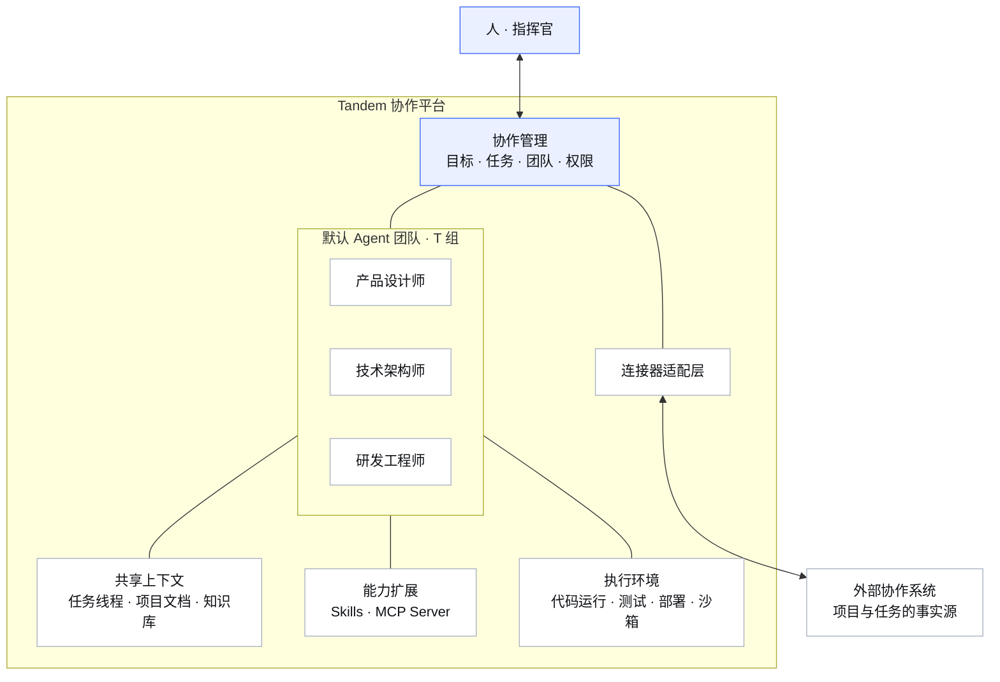

# Tandem 产品设计文档（v2）

> 当前变更（2026-11-14）：用户已授权按项目、文档、任务、分析、Agents、连接器、后台管理重构。新增业务与视觉以 [08 产品重构与验收](08-产品重构与验收.md) 和 apps/web/DESIGN.md 为准，覆盖下文旧六入口、旧Logo、旧视觉和仅外部项目任务的规定；其余权限、草案、进程与隔离约束继续有效。下文旧验收为历史记录。

> Tandem — 一个人带领 AI Agent 团队，推进多团队、多项目交付的开源协作平台。
>
> v2 · 2026-11-12 · 作为后续重构的产品设计基线，从目标用户与交付场景出发。

---

## 0. 设计原则

产品围绕三条原则设计：

- **产品独立**——围绕用户目标组织功能，外部协作系统通过连接器接入；
- **Agent 团队是核心**——默认 T 组承担设计、架构、研发与交付，人负责方向和关键决策；
- **观察服务行动**——让人看清该关注什么，并能直接派活或处理阻塞。

v2 的唯一判断标准：**每一个功能，要么帮人看清该关注什么，要么帮 Agent 多干活。两者都不占的，删。**

## 1. 一句话定位

**你是指挥官，Agent 团队是执行者，Tandem 让你看清全局、派活出去、坐等结果。**

人与 Agent 团队的协作架构：



人通过 Tandem 与 T 组协作；T 组共享上下文、工具与执行环境，外部协作系统通过连接器接入。图中连线表示架构关联，不表示执行顺序。

## 2. 四个产品支柱（v2 全部功能，仅此四项）

### 支柱一：指挥官视图（观察力）—— "我该关注什么"

一个页面回答指挥官的六个问题，按优先级排列：

```
① 需要我决策的（Agent 提请的审批 · 阻塞中的任务 · 逾期）
② 谁过载了（人 & Agent：待办需求 / 各自可用容量 + 期限压力 → 负载指数）
③ 谁有空档（按空档起止排序，含 Agent 空闲算力）
④ 哪个项目在变糟（进度回退 · 燃尽异常 · 延期趋势）
⑤ 临时任务给谁最合适（输入一句话 → 推荐：负载最低+技能匹配+期限兼容）
⑥ 团队快照（N 团队 × M 项目 × 人 + Agent 的当日活跃/产出）
```

**负载指数**（Load Index，0-100，取代裸工时罗列）：>80 红、60-80 黄、<60 绿。人按可用工时、期限和并行任务估算，Agent 按执行队列、并发容量、预算和期限估算；统一展示尺度，分别解释计算依据。缺少估算时显示“待评估”，不把未知当空闲；指挥官无需理解算力细节即可派活。

### 支柱二：Agent 团队（人机协作的核心）

- **Agent 即成员**：每个 Agent 有身份（名字/头像/职责/技能标签）、有任务、有产出、有负载，与人在一切视图里并列；
- **默认 T 组**：内置由产品设计师、技术架构师、研发工程师三个 Agent Bot 组成的三人小组，可独立承担产品开发、快速项目交付和高质量演示级 Demo；用户可整组派活，也可单独指派成员；
- **各司其职**：三个角色共同覆盖规划、设计、架构、编码、测试、部署和交付；记录、汇报、异常提醒是各成员的通用能力，默认不再额外创建 Bot。保留自定义角色和团队的能力；
- **可扩展能力**：一期支持 T 组安装和使用 Skills、调用已授权的 MCP Server 工具；后续支持从日常交付中自主积累 Skills，并提供执行沙箱管理；
- **自动 Loop**：给 Agent 一个目标（如"把 PRD 变成排期"），Agent 自主循环 `计划→取上下文→执行→自检→提交草案`，直到目标达成或**需要人类决策时停下等你**——停下本身就是一种交付；
- **信息共享**：上下文三层——任务线程（局部）、项目文档（共享）、知识检索（在授权范围内检索文档与历史决策）。Agent 通过共享产物、明确的交接和验收记录协作，不需要另建聊天系统；
- **安全边界**：授权范围内的设计、编码、自检和隔离预览可自主推进；Agent 的一切对外写操作强制走草案审批，合并、发布和生产变更也须人工确认。T 组的独立交付能力不代表获得无限权限。

#### 默认团队：T 组

**T 组 = 精通 UI/UX 的高级前沿产品设计师 + 简洁务实前沿的高级技术架构师 + 严谨的高级研发工程师。** 三位都是有独立身份、职责和产物的 Agent Bot，围绕同一个交付目标协作。

| 成员 | 核心职责 | 主要交付物与验收责任 |
|---|---|---|
| 产品设计师 | 澄清用户场景与产品目标，定义范围、信息架构、关键流程和 UI/UX；关注前沿体验，同时保证易用性与可实现性 | 需求与验收标准、交互流程、视觉方案/原型、组件与状态规范；验收实现的体验、响应式布局和视觉一致性 |
| 技术架构师 | 选择满足目标的最简方案，划定模块和数据边界，设计接口、权限及系统部署架构；明确环境划分、资源配置、服务拓扑、配置与密钥、监控、发布和回滚策略 | 技术方案、接口与数据契约、部署设计、开发拆解、关键决策记录；审查实现与部署的正确性、可维护性和交付风险 |
| 研发工程师 | 负责开发、测试和部署：依据设计完成前后端开发、集成、测试、修复，编写部署脚本，执行获批部署、上线验证及必要回滚；对实际运行结果负责 | 可运行代码、测试与构建结果、部署脚本/配置模板、预览或部署入口、部署与健康检查记录、运行/回滚说明和已知限制 |

默认由产品设计师整理目标与验收标准，技术架构师组织技术拆解和部署设计，研发工程师负责开发、测试和部署执行；阶段推进由系统编排，不增加第四个“管理者 Bot”。体验由设计师验收，技术与部署方案由架构师复核，工程师提交实际测试、部署及验证证据。需人工批准的发布由指挥官确认后，仍由研发工程师继续执行和验证，不把部署责任转交给指挥官。

**两种交付模式，同一支 T 组：**

| 模式 | 默认工作方式 | 完成标准 |
|---|---|---|
| 产品开发 / 项目交付 | 明确范围与验收条件 → 产品/技术/部署方案 → 按里程碑实现 → 测试与交叉验收 → 获批部署与验证 → 提交交付包 | 核心流程、约定测试及交叉验收通过；目标要求上线时，须完成目标环境部署与健康检查，附部署记录和回滚说明；待批准或部署失败不能标记为已上线 |
| 演示级 Demo | 锁定目标受众和一条完整演示路径，压缩非核心范围，优先打磨关键页面与交互；可使用明确标识的模拟数据 | 可启动、可预览、可复现完整演示路径；附演示脚本、模拟范围、未实现项及转正式产品的差距，不能以静态截图或未验证的代码代替可运行 Demo |

**默认协作流程：**

```text
指挥官提交目标、期限、交付模式与预算
  → 产品设计师：明确场景、范围与验收标准
  → 产品设计师 + 技术架构师：设计方案 / 技术与部署方案（依赖明确后可并行）
  → 研发工程师：开发、测试、准备部署脚本并提交证据
  → 产品设计师验体验 + 技术架构师审技术及部署方案
  → 不通过：带具体问题回到实现；通过：提交待部署版本或 Demo 预览
  → 需要外部写入或发布：提交草案，等待指挥官确认
  → 研发工程师：执行获批部署、健康检查；失败时按获批策略回滚并反馈
  → 汇总交付物、运行入口、验证记录和已知限制
```

仅在目标歧义、范围变化、预算不足或需人工批准时提请决策，其余阶段在已授权范围内连续推进。交接必须包含产物版本、结论、待解决问题和验收结果；达到预算或返工次数上限时暂停并说明原因。

**Agents 页面中的默认体验：**首次初始化工作空间时创建一个 T 组和三个角色实例，重复初始化不重复创建。用户配置模型、项目上下文及执行环境后即可整组派活；未配置项明确显示“待配置”。团队视图在 Agents 页与任务线程中展示共同目标、当前阶段、三人状态、待决策项、预算消耗和交付物。T 组可复用到多个项目，但每次执行的工作目录、权限和上下文按项目隔离。

#### 能力扩展：Skills 与 MCP Server（一期）

**Skills 是可复用的工作方法与配套资源，MCP Server 提供可调用的工具，执行环境负责实际运行。** 三者分别管理，在派活时组合使用。

| 能力 | 一期范围 | 使用体验 |
|---|---|---|
| Skills 管理 | 从指定仓库或技能包安装，查看说明、来源、版本、依赖与所需权限；支持启用/停用、升级/回退、卸载；绑定到 T 组或具体成员，并限定项目范围 | 指挥官可安装配置；T 组也可在已授权来源与权限范围内自主安装、选择和使用技能。运行记录展示使用的技能版本及结果，未满足依赖时说明原因 |
| MCP Server 管理 | 添加/编辑服务，配置连接方式和凭证引用，测试连接，查看健康状态和可用工具；支持启用/停用、移除及团队/成员/项目授权 | 为 T 组提供设计、开发、测试、部署等工具；连接成功不等于授予全部工具权限，外部写操作仍走草案审批 |

管理者决定来源、可用范围和权限，成员只能使用授权给自己的能力。Skills 和 MCP 工具不能覆盖项目权限或审批规则；一次运行固定所用技能版本和工具配置，升级不暗中改变进行中的工作，停用或撤权立即阻止后续使用。

#### 自主积累 Skills 与执行沙箱管理（后续）

- **自主积累 Skills**：T 组从已验证的开发、测试、部署过程和问题复盘中识别可复用方法，自动整理适用场景、步骤、资源、验证样例和来源，形成候选技能。通过去重、脱敏和验证后，在既有授权范围内沉淀为项目/团队技能；扩大共享范围或新增权限时再提请确认。保留版本、使用效果和失败记录，可修订、停用及回退，避免把整段聊天直接当技能。
- **执行沙箱管理**：提供环境模板、创建/启停/销毁、资源与网络权限、工作目录、有效期、运行日志、占用状态和清理操作。T 组可按任务申请已授权的环境，结束后按策略回收。**一期具备基本隔离执行能力，后续再提供完整管理界面与环境池**，不把后续管理功能当作一期可以无隔离执行的理由。

### 支柱三：任务流（人与 Agent 共用的工作台）

- 看板 + 列表，每个任务卡片上"负责人"可能是人可能是 Agent，视觉同样呈现（Agent 用几何徽标区分）；
- 任务内是**线程**（thread）：人可以留言，Agent 汇报进展、贴 diff、提请决策——任务的全部上下文都在这一条线里；
- 状态流转与工时登记对人和 Agent 是同一套操作（Agent 走草案，人直接执行）。

### 支柱四：连接器（对接同步）

产品与对接彻底分离。具体系统通过连接器接入，其名称和配置只出现在连接管理中。**连接器只做三件事：读（按权限实时读取并短时缓存项目/任务/工时）、写（草案落库）、映射（字段与状态语义对齐）。** 更换/叠加连接器，指挥官视图、Agent 团队、任务流一字不动，不建立下游业务数据的长期副本。

## 3. 页面地图（6 个一级入口）

```
关注        支柱一：六个问题的答案（默认首页，指挥官每天看的第一屏）
Agents      支柱二：默认 T 组 + 自定义团队（整组派活/成员职责/阶段进度/交付物）
任务        支柱三：任务流（看板⇄列表 + 任务线程抽屉）
观察        支柱一的深潜：负载排行/空档日历/多维度切片（团队×项目×人×Agent）
连接        支柱四：连接器管理（禅道/Jira…健康状态/同步日志）
能力        支柱二：Skills 管理 / MCP Server 管理（一期）；执行沙箱管理（后续）

⌘K 全局命令：搜任务/项目/人/Agent + "临时任务给谁" 快捷入口
```

没有的页面：没有仪表盘编辑器、没有自定义报表、没有工作流配置器——**易上手 > 可配置**。

“能力”页按 Skills、MCP Server 分栏管理，后续增加执行沙箱页签；Agents 页展示成员已绑定的能力并链接到管理入口。业务连接器仍在“连接”页，避免混淆业务数据接入与 Agent 工具扩展。

## 4. 关键交互设计

### 4.1 派活（指挥官最高频动作）

文档与产品演示中的人员统一使用张三、李四等虚构示例名，不使用真实姓名。

```
输入框（关注页顶部常驻）：
"做个登录页改版方案，本周五前"
   │
   ▼ 系统分析 → 三个候选（人+Agent 混合）
   ┌────────────────────────────────────────┐
   │ ① 张三    负载 45 · 前端技能匹配 92% · 周五有空 ✅ 推荐 │
   │ ② T 组·产品设计师  空闲 · 近期同类任务 7 个 · 可接单       │
   │ ③ 李四    负载 78 · 技能匹配 88% · 周五有空 ⚠ 已接近过载   │
   └────────────────────────────────────────┘
   一键创建任务（经连接器写入外部系统）或交给 T 组 / 指定 Agent 执行
```

### 4.2 Agent 提请决策（自动 loop 的停下点）

```
T 组·技术架构师：已将 PRD 拆解为 12 个任务（草案 #d81）
  ├─ #1-#8 无歧义，建议直接执行
  ├─ #9-#10 支付方案有 A/B 两案，需要你选择
  └─ #11-#12 依赖设计稿，建议先挂起
  [查看草案] [批准全部] [逐条审] [退回修改]
```

### 4.3 视觉语言（DeepSeek 基调 → Tandem 化）

| 维度 | 规范（实测 DeepSeek 提取） |
|---|---|
| 主色 | `#3964FE`（DeepSeek 蓝），仅用于：主按钮、关键数字、选中态、链接 |
| 中性 | 正文 `#0F1115`，次级 `#81858C`，底 `#F9FAFB`，边框 `#E9EAF0` |
| 字体 | Inter + 系统栈，14px 正文，标题不加粗放大只加字重 600 |
| 形 | **无阴影、无渐变、无圆角>10px**；卡片=1px 边框 + 白底；状态用 6px 圆点 |
| 动效 | 只保留 150ms hover 变色，其余全部删除 |
| Logo | 单色字标 "Tandem" + 双人自行车语义的极简符号（两条并行线+交点），不用 emoji |

原则：**界面安静得像一张纸，数字和状态自己会说话。**

## 5. 权限模型

- 身份继承下游系统（禅道/Jira 账号），Tandem 不设密码库；
- 指挥官 = 团队负责人（下游角色识别，白名单兜底）；
- Agent 挂靠创建人：**Agent 的权限 ≤ 创建人权限**，其落库操作以创建人身份走草案。
- T 组共享的是授权内的产物，加入同一团队不自动扩大项目或知识访问权限；执行时同时校验创建人、发起人和当前项目授权，审批人不能借确认操作替 Agent 提权。

## 6. Roadmap（重构目标里程碑）

| 版本 | 主题 | 交付 |
|---|---|---|
| **v2.0（一期）** | T 组交付与能力管理 | PG + pgvector、工作空间与权限、基础页面；默认三人组与整组派活；Skills 安装/管理/使用、MCP Server 管理与授权调用；阶段协作、任务线程、草案审批、基本隔离执行与预览，打通 Demo 和获批部署验证流程 |
| **v2.1（后续）** | 技能积累与沙箱管理 | 从日常交付自主提炼、验证、沉淀及迭代 Skills；执行沙箱模板、生命周期、资源/网络配置、日志与回收管理 |
| **v2.2** | 可靠执行 + 项目知识 | 多项目并行与预算治理完善；项目文档增量向量化、权限过滤、引用回链；扩展产品开发与项目交付场景 |
| **v2.3** | 观察力深潜 | 负载指数全量上线 + 空档日历 + 智能派活推荐 + 第二连接器 |

## 7. 不做什么（写进 DNA）

- 不做表单设计器/自定义工作流/低代码——复杂度的源头；
- 不做下游业务数据的第二事实源——项目、任务、状态与工时以连接系统为准；本地数据库只保存 Tandem 自有的团队、运行记录、草案、文档与交付产物索引，T 组内部执行步骤不是另一套业务任务；
- 不做 Agent 间 IM——线程和共享记忆已覆盖，再加就是灾难；
- 不做通用页面搭建器——固定产品入口；Skills、MCP Server 和执行沙箱只提供完成任务所需的能力配置。
