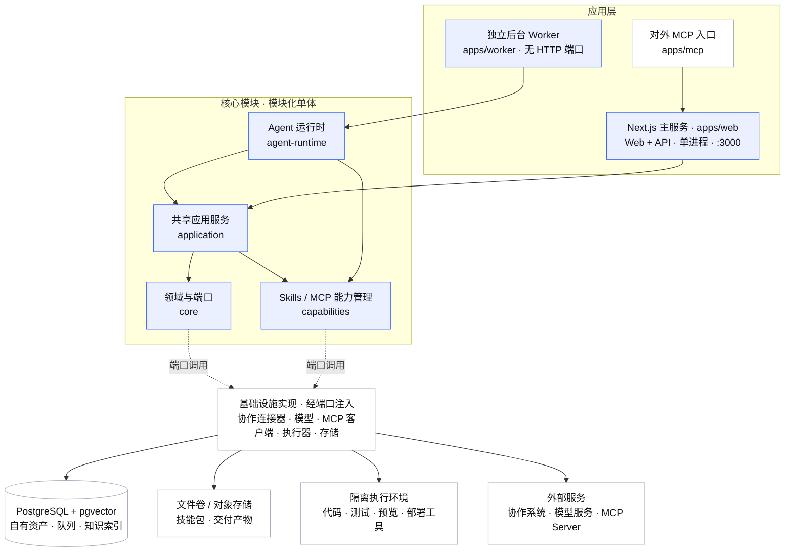
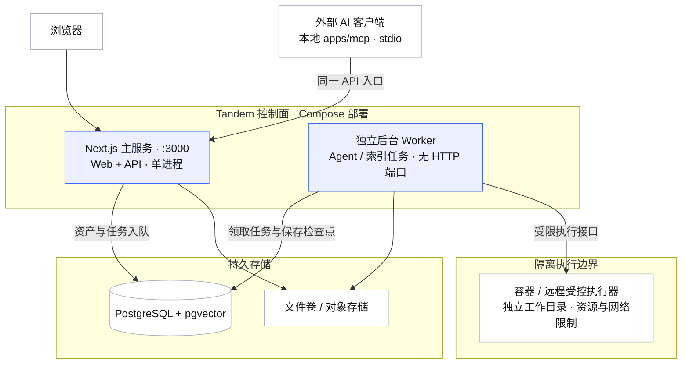
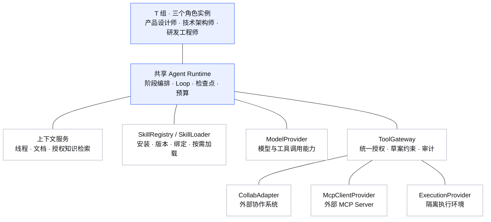

# Tandem 技术架构文档（v2）

> 配套 [01-产品设计文档 v2](./01-产品设计文档.md)。围绕指挥官视图、T 组、任务流和连接器设计。
>
> v2 · 2026-11-12 修订 · **后续重构的技术设计基线：PostgreSQL + pgvector。** 以产品目标和交付场景决定架构，不受既有实现约束。

---

## 1. 架构总览

**一条铁律：产品是产品，对接是对接，Agent 是运行时能力；下游业务事实与 Tandem 自有协作资产分开管理。**

采用 **Next.js 主服务（Web + API，单进程、单 HTTP 端口）+ 独立 Worker（无 HTTP 端口）+ PostgreSQL/pgvector + 隔离执行环境**。代码按模块化单体组织，面向 T 组的三人协作，优先解决可靠交接、可运行交付与权限隔离；不先拆微服务，不同时维护两套数据库后端，不引入独立向量数据库、消息中间件和通用工作流编辑器。

**逻辑架构：应用入口、核心模块与基础设施。**



图中展示模块使用关系；虚线表示通过注入的端口调用基础设施，不表示 `core` 导入具体适配器。页面与 API 共用主服务的一个 HTTP 端口，主服务与 Worker 通过 PG 持久队列衔接，进程与隔离边界见下方部署图。

依赖规则：`core` 只定义领域与端口；`application` 组织用例、授权与草案服务；`agent-runtime` 使用共享应用服务和领域端口；连接器、数据库、模型和执行环境实现端口；应用启动入口组装依赖。共享模块不依赖 Next.js，Worker 不导入页面或 Route Handler。产品路由和角色提示不依赖具体下游 SDK，也不把其名称或状态原词带进产品流程。

### 1.1 面向产品场景的架构判断

| 产品场景 | 核心技术要求 | 架构选择 |
|---|---|---|
| 多团队、多项目共享协作 | 事务一致性、资源授权、并发访问 | PG 统一存储自有资产，工作空间/项目作用域贯穿所有入口 |
| T 组三人独立推进交付 | 明确依赖、交接、验收和返工边界 | 固定角色模板 + 阶段编排，阶段内使用 Agent Loop |
| 快速交付可运行 Demo | 编码、构建、测试、预览与文件交付 | 独立执行环境与产物存储，按交付证据判定完成 |
| 长任务与人工决策 | 暂停、重启恢复、预算约束 | PG 持久队列 + 后台 worker + 检查点 |
| 项目知识与历史决策复用 | 中文召回、权限过滤、版本和引用 | pgvector + PG 全文检索，统一文档权限 |
| 多种外部协作系统接入 | 数据事实不重复、语义一致、继承用户权限 | 统一连接器端口与会话作用域，读缓存、写审批 |
| 一期扩展 T 组能力 | 安装/加载 Skills，管理 MCP Server 并授权工具 | 能力注册与绑定、固定版本、统一工具调用入口 |
| 后续自主积累与环境治理 | 技能提炼验证、执行环境生命周期管理 | 技能候选与版本评估流程、沙箱管理端口 |

实现优先围绕“提交目标 → T 组协作 → 可运行交付物 → 验收”形成闭环；技术模块服务这条路径，避免先建设与交付无关的通用平台能力。

### 1.2 进程与端口决策

| 边界 | 一期决策 | 理由与代价 |
|---|---|---|
| Web 与 API | 合并为 Next.js 主服务，默认 `:3000`，页面和 `/api/*` 同源 | 同一产品暂无独立发布、扩容需求；减少服务、代理和联调配置。接受页面与 API 同进程的故障范围 |
| HTTP 请求与 Agent 长任务 | Worker 独立进程，无额外 HTTP 监听端口 | 隔离运行故障、内存占用与重启影响；仅更新主服务时可保持 Worker 运行。代价是多管理一个后台进程及生命周期 |
| 控制面与代码执行 | 保持隔离执行环境 | 技能脚本、构建、测试不能与控制面共享无限权限；普通进程拆分不等于执行沙箱 |

Next.js Route Handlers 提供 API 入口，业务逻辑放在共享应用服务中；无需额外 Fastify 服务或 Web 到独立 API 的 rewrite 代理。[Next.js 后端能力说明](https://nextjs.org/docs/app/guides/backend-for-frontend)

独立 Worker 的价值是故障、资源和生命周期隔离；异步模型请求并不天然阻塞主进程，分进程也不会自动保证任务不丢失。可靠性仍依赖持久队列、检查点、租约和幂等处理。只有出现独立 API 发布/扩容、协议或团队边界等明确需求时，才重新评估拆分 Web/API。

## 2. 目录与部署边界（目标态）

```text
tandem/
├── apps/
│   ├── web/                 # Next.js + antd；页面与 Route Handlers 共用 :3000
│   ├── worker/              # 独立进程；队列消费、Agent/索引任务；无 HTTP 端口
│   └── mcp/                 # stdio；认证后请求主服务 API，不另建草案状态
├── packages/
│   ├── core/                # 领域模型、权限/草案规则、ports；无数据库驱动依赖
│   ├── application/         # 主服务与 Worker 共用的用例、授权和草案服务
│   ├── agent-runtime/       # T 组编排、角色模板、Loop、上下文组装
│   ├── capabilities/        # Skills/MCP 注册、授权绑定与版本解析；一期
│   └── storage-postgres/    # 异步仓储、事务、schema 管理、队列与检索 SQL
├── adapters/
│   ├── zentao/              # 首个协作系统连接器；其他连接器实现同一端口
│   ├── model/               # 聊天、工具调用、embedding 能力适配
│   ├── mcp-client/          # 连接外部 MCP Server；与 apps/mcp 对外服务分开
│   └── execution/           # 隔离工作目录、命令、测试、预览和产物存储
└── docs/
```

基础部署用一份 Compose 描述 Next.js 主服务、独立 Worker 与带 pgvector 的 PG。主服务采用长驻 Node.js 进程，同时处理页面与 Route Handlers；Worker 采用独立 Node.js 入口，主服务和 Worker 可复用应用镜像、按不同命令启动。对用户只提供主服务的一个 HTTP 端口，PG 使用内部网络，Worker 不启动 HTTP 服务；外部 AI 客户端按需启动的 stdio MCP 入口也不增加 HTTP 端口。

主服务与 Worker 分别配置资源限制、重启策略和健康检查；Worker 通过进程检查及 PG 心跳判断健康，无需为健康检查单独开 HTTP 端口。发布时按组件控制重启范围；更新共享运行逻辑时，Worker 也需受控重启。Worker 停止前停止领取新任务，按截止时间完成或保存可恢复状态，再由租约机制接管。

代码执行环境与控制面分离，可为隔离容器或远程受控执行器；不把普通 Git worktree 当安全沙箱。数据库内部端口和受控预览入口不属于主服务的第二套 API，分别按访问策略管理。

数据库与扩展锁定经过验证的兼容版本，不使用浮动 `latest`；安装时检查 `vector` 扩展可用性。连接串、模型密钥和会话凭证从环境或密钥存储注入；只提交示例配置。文件产物单机先用受控数据卷，按相同 `ArtifactStore` 端口可接对象存储。

**部署架构：控制面、存储与执行环境分离。**



箭头表示访问关系，不表示执行顺序。主服务负责 HTTP 请求，Worker 独立执行队列任务，两者共用领域与应用服务代码；执行器不持有控制面数据库凭证，产物通过受控接口回收。图中隔离执行能力一期具备，完整沙箱管理在后续提供。

## 3. 核心抽象与运行规则

### 3.1 端口与资源引用：对接隔离的基础

通过 `CollabAdapter` 抽象外部协作能力，资源引用同时标识连接实例、资源类型和外部 ID。目标契约示意：

```ts
interface ExternalRef {
  connectionId: string       // 连接实例；同类系统的两个实例也必须区分
  resourceType: 'project' | 'task' | 'execution'
  externalId: string        // 不假设所有系统都使用数字 ID
}

interface ExecutionScope {
  workspaceId: string       // Tandem 本地的权限与配置边界，不复制下游组织树
  projectRef?: ExternalRef
  initiatorId: string
  ownerId: string
  credentialRef: string     // 引用可撤销的授权，禁止在 run/job 中保存明文凭证
}
```

- `CollabAdapter`：读/写/映射与能力声明；具体异常转成统一的“不支持、无权限、会话过期、冲突、暂时不可用”等结果。
- `Repository / UnitOfWork`：异步仓储与事务边界；业务服务不依赖具体数据库驱动。
- `ModelProvider / EmbeddingProvider`：分别协商工具调用、结构化输出、上下文长度与向量维度；聊天与 embedding 可使用不同模型。
- `ExecutionProvider / ArtifactStore`：代码工作区、命令、测试、预览与文件产物；执行结果统一包含状态、产物引用和验证证据。
- `SkillRegistry / SkillLoader`：技能包安装、版本解析、作用域绑定和按需加载；安装与使用受相同能力授权约束。
- `McpClientProvider / ToolGateway`：连接外部 MCP Server、发现工具、执行经授权的调用，统一审计与副作用处理；不直接向模型暴露凭证。

产品模型保存连接引用和本地配置，不镜像外部任务全集。连接器能力决定哪些操作可用，不能假定每个平台都支持工时、删除或同一状态流。只有应用服务能调用外部写端口；Agent 工具只提出草案。

### 3.2 统一工作者与负载

人和 Agent 共享 `Worker` 展示模型（身份、技能、负载、可用性、估算依据），计算由不同策略注入；页面无需理解底层容量算法。

| 对象 | 负载依据 | 缺失数据处理 |
|---|---|---|
| 人 | 剩余工时 / 截止日前可用工时、并行任务数、期限压力 | 无期限或工时不全时降低置信度并显示原因 |
| Agent | 预计排队与执行时长 / 可用并发窗口、模型限流、预算余量 | 无历史运行样本时给出区间或“待评估”，不伪造工时 |
| T 组 | 阶段依赖的关键路径及最繁忙成员的容量 | 不简单把三个成员容量相加；阻塞单独呈现 |

分项先归一化，再输出 0–100 与置信度。Agent 的 token、成本和运行时长单独计量，不自动折算成业务工时；外部工时登记仍须明确口径与草案审批。

### 3.3 T 组：固定团队模板 + 明确的阶段协作

默认模板 `t-group@1` 包含三个角色，分别实例化为独立 Agent；通用规划、记录和提醒能力并入三人职责，不添加协调者 Bot。

**Agent 能力架构：角色实例与共享运行时分离。**



连线表示能力依赖，不表示交付流程。三个角色使用同一套运行时基础能力，按各自授权加载 Skills、上下文与工具；图中的模块不代表新增 Agent。知识检索与沙箱管理按路线图分期建设。

| 角色键 | 默认职责 | 必须提交的产物 |
|---|---|---|
| `product_designer` | 精通 UI/UX 的高级前沿产品设计师；范围、体验与设计验收 | 需求/验收清单、流程与视觉方案、体验验收记录 |
| `tech_architect` | 简洁务实前沿的高级技术架构师；技术与部署设计、依赖拆解和技术复核 | 技术方案、接口契约、环境/资源/拓扑设计、配置与密钥策略、监控/发布/回滚方案、验收记录 |
| `software_engineer` | 严谨的高级研发工程师；开发、测试、修复、部署执行及运行验证 | 代码、测试/构建证据、部署脚本与配置模板、预览/部署入口、部署与健康检查记录、运行/回滚说明 |

模板保存版本、职责、工具白名单和预算默认值；实例可绑定不同模型，不将角色固定到某厂商。工作空间初始化在事务中幂等创建 T 组、三个 Agent 和成员关系，唯一键防止重复；初始化不覆盖用户后续配置，模板升级须显式应用。

一次 `team_run` 表示一次内部交付目标，包含模式（`product` / `demo`）、范围、验收条件、预算、执行身份和产物版本。它可以关联外部任务，也可先作为尚未落库的目标；内部步骤不是第二套业务任务。

编排顺序为 `定义目标 → 产品/技术/部署设计 → 开发与测试 → 体验/技术及部署复核 → 获批部署与验证 → 汇总交付`。以阶段依赖图执行，依赖满足的设计与架构、两类复核可并行；每次交接记录输入/输出产物版本、责任 Agent、问题与判定，不靠向量相似度推断“上一阶段完成”。Demo 可在隔离预览验收后交付；目标要求上线时，部署与健康检查通过才满足完成条件。

部署计划绑定目标环境、制品版本/校验值、配置引用、执行步骤、验证标准及回滚策略；架构师负责设计与复核，工程师负责执行和证据。人工批准绑定该计划版本，修改制品或环境后重新确认；部署失败时执行已批准的回滚策略，超出该策略则暂停提请决策。保存实际部署版本、结果与回滚状态，不能以构建成功代替上线成功。

默认限制一个目标内的返工轮次、时长、token 与成本；预算在团队和单 Agent 两级扣减，重试/续跑不能重置额度。三位 Agent 对同一交付版本完成自检或复核后才可通过；存在待审批动作时标明“交付待确认”，不能将模型调用 `finish` 等同于产品已完成或已发布。

### 3.4 草案、审批与外部副作用

统一流程：`propose → review → approve → execute`。人通过 UI 明确提交的直接操作也走同一校验/执行服务，不必增加第二次确认；Agent 和 MCP 提案必须经可验证的人工确认，模型不能持有审批权限。

- 草案保存 `workspace/project scope`、发起人、挂靠人、执行身份、内容版本/hash、过期时间和逐项动作；批准绑定具体版本，修改内容后重新审批。
- 查询、续跑、批准、丢弃和执行均校验资源访问权；执行范围受挂靠人、发起人及项目授权共同约束。批准人须有审批资格，但其会话不能替换绑定身份从而提权。
- 执行前重新校验当前权限、会话、连接器能力与目标状态；授权失效时进入 `waiting_auth`，不使用全局账号兜底。
- 批准记录和待执行 job 在同一 PG 事务中写入；用条件更新/版本号确保一次状态抢占。外部网络调用不放在长数据库事务里。
- 每项动作保存幂等键、执行状态和外部回执。部分成功保留为 `partial`；超时且无法确认外部是否成功时记为 `unknown` 并核对，不直接重试创建或记工时。
- PG 事务不能覆盖外部 API，队列重试也不保证外部副作用“恰好一次”。优先使用连接器提供的幂等能力；不支持时走状态核对或人工决策。
- 外部写入成功后 `drop` 对应 TTL 缓存；结果不确定时也使相关缓存失效，并重新读取事实源。

Tandem 内部的运行记录、检查点、文档和草案保存可按授权自动完成；“必须审批”针对对外副作用，不要求每写一条日志都审批。代码合并、推送、对外发布、生产变更纳入同一审批策略。

### 3.5 可恢复运行与真实执行环境

```text
queued → running → completed
             ├→ waiting_decision / waiting_approval / waiting_auth → queued
             ├→ failed（满足重试条件时重新排队）
             └→ cancelled
```

状态迁移由运行时按证据控制；`completed` 必须满足该阶段验收条件。暂停释放执行槽位，待决策与授权恢复不依靠原 HTTP 请求或内存对象。

**后台执行：**主服务的 Route Handler 调用应用服务，持久化运行与待执行 job 后返回 ID；独立 Worker 从 PG `jobs` 表领取任务，不把 Agent Loop 挂在 HTTP 请求或请求结束后的内存回调中。用短事务 `FOR UPDATE SKIP LOCKED` 抢占，提交后才调用模型/工具；保存租约、心跳、重试次数和下次执行时间。该锁机制适用于队列领取，不用于查询业务全局一致视图。[PostgreSQL SELECT 文档](https://www.postgresql.org/docs/current/sql-select.html)

每次领取生成递增的执行令牌，检查点更新须匹配当前令牌，防止过期 worker 覆盖新结果；外部写仍通过草案动作去重。步骤保存结构化状态、产物引用、必要上下文和待决策项；续跑沿用 `run_id` 与累计预算，原子写入答案并排队，拒绝重复答复和并发续跑。重启后只恢复可安全重放的步骤；副作用结果未知时先核对。取消时停止后续调度并通知执行环境终止进程，已发生的外部动作不能假称回滚。

**代码执行：**为每个目标分配独立分支/worktree 与隔离执行环境；同一工作树默认只有一个写入者，其他角色通过产物版本审阅，确需并行写时使用不同分支再集成。配置目录、命令、网络和资源限额，凭证按作用域短时注入；不向 Agent 暴露宿主 Docker socket 或控制面数据库凭证。内部预览采用访问控制和有效期，不默认公开暴露。

**交付契约：**`ExecutionResult` 包含 commit/diff、构建与测试退出状态、可访问预览及过期时间、必要截图、启动说明和已知限制；部署目标还包含制品版本、环境引用、审批记录、部署/健康检查及回滚结果。截图证明视觉效果，运行/测试记录证明功能；Demo 必须附模拟数据范围和可复现演示脚本。缺少执行器时显示“仅能生成方案，无法完成代码交付”，引导配置执行环境后再启动完整交付流程。

**模型接入：**通过 provider 能力检测决定工具调用、结构化输出与取消策略，可接入兼容协议端点或厂商原生协议，不假设所有端点能力相同；API key 保存在密钥配置中。系统规则与检索材料分离，工具授权由服务端执行，不能仅靠提示词约束。

### 3.6 项目知识与 RAG：权限先于相关性

三层上下文职责明确：任务线程保留当前目标的协作记录；项目文档存放需求、设计、决策和交付说明；向量检索只寻找相关知识，不承担调度、权限或事实状态判断。角色必读的当前验收条件与阶段产物直接按 ID/版本加载，不能依赖 top-k 恰好命中。

```text
文档版本变化 → 提交索引 job → 切块/内容 hash → embedding → 发布可检索版本
查询 → 确定当前授权范围 → 同范围关键词召回 + 向量召回
     → 排名融合/去重 → 可选重排 → 版本与权限复核 → 引用片段 → 模型上下文
```

- **索引范围**：默认只索引 Tandem 自有文档、显式归档的决策与验收结论；不自动把所有对话当长期记忆，不长期向量化外部任务/工时副本。外部实时事实通过当前会话查询；日志与检查点只保留必要引用和脱敏摘要，不直接归档完整工具响应。
- **中文与混合检索**：在 v2.2 知识检索阶段采用应用层中文分词 + PG `tsvector/GIN` 关键词检索 + pgvector 向量检索，以 RRF 融合名次。分词器通过中文需求、术语和代码标识符样例评估后锁定；PG 原生 `ts_rank/ts_rank_cd` 不称为 BM25，后续只有实测召回不足才评估额外搜索扩展。[PostgreSQL 全文检索文档](https://www.postgresql.org/docs/current/textsearch-controls.html)
- **向量配置**：每个 embedding 集合固定模型、维度、距离度量和切块版本，查询与文档使用同一配置；换模型建立新集合后台重建、验证后切换，不在同一索引混用不同向量空间。
- **索引策略**：小规模先使用授权范围内的精确向量检索，基于真实数据量、延迟和召回率再启用 HNSW。HNSW/IVFFlat 的 `vector` 索引支持到 2,000 维，`halfvec` 到 4,000 维；模型维度须与选定类型/索引兼容，不把索引限制误当所有向量存储限制。[pgvector 索引说明](https://github.com/pgvector/pgvector#hnsw)
- **权限过滤与召回**：关键词、向量两路 SQL 都带授权条件；不能先跨项目取 top-k 再在应用层删除越权内容。近似索引扫描后的过滤可能导致结果不足，可按实测使用迭代扫描或回退到授权集合精确检索；过滤不能为补足数量而放宽。[pgvector 过滤说明](https://github.com/pgvector/pgvector#filtering)
- **版本与删除**：索引 job 绑定文档版本，只更新变化的块；旧 job 不得覆盖新版本。文档删除/撤权立即使其不可检索，异步清理旧块；索引尚未更新时标明版本并直接读取授权的当前文档。
- **引用与信任**：输出携带文档、版本、章节/片段引用；知识内容以数据而非系统指令传入。缺证据时说明未知，不用过期记忆代替最新业务事实。

### 3.7 Skills 与 MCP Server 管理（一期）

**三种能力分别建模：Skills 定义可复用的方法和配套资源，MCP Server 提供工具，ExecutionProvider 提供运行环境。** `packages/capabilities` 是单体内的能力模块，不另拆管理微服务。

**Skills 安装与加载：**

- 支持从指定仓库的固定版本/提交或上传技能包安装；保存技能说明（`SKILL.md`）、脚本/模板等资源、来源、版本与内容 hash。安装器检查包结构、路径边界、依赖和所需权限，不在 API 宿主机直接执行安装脚本。
- 以工作空间、团队/Agent、项目范围绑定启用版本。T 组可在预先授权的来源与权限内调用安装工具；超出范围时生成配置申请，不在后台扩大权限。安装失败不替换已启用版本。
- 运行时先加载可用技能摘要，选中后按需加载正文与资源；脚本交由受限执行器运行，工具调用经过 `ToolGateway`。技能说明不能覆盖系统权限或外部写审批。
- 支持查看、安装、启用/停用、升级/回退、卸载及使用记录。每次运行固定技能版本与资源 hash；升级影响后续运行，停用/撤权则阻止进行中运行的后续使用。历史版本可按保留策略留档供审计，卸载后不得继续执行。

**MCP Server 注册与调用：**

- 一期管理外部 MCP Server 的连接配置、凭证引用、启停、健康状态、工具目录及授权绑定；支持远程连接与受控 stdio 服务，具体传输协议由客户端适配器协商。stdio 进程在受控执行环境启动，禁止任意命令在 API 宿主机运行。
- 连接测试只检查握手、可达性和工具目录，不调用会改变业务状态的工具。工具使用 `serverId + toolName` 命名空间，按团队/成员/项目配置允许调用的工具及作用类型。
- 工具的读写性质由本地策略配置和校验，不能只相信服务自述；未分类工具默认不可执行。外部写工具统一转成草案，审批后仍由网关执行，保存输入摘要、绑定身份、配置版本、回执和结果不确定状态。
- 凭证按实际执行用户/项目授权解析；服务注册者的高权限凭证不能自动成为所有成员的权限。调用前重验权限，设置超时、并发与输出大小限制；服务停用后禁止新调用，对在途调用记录终止或结果未知，不声称撤销已发生的外部动作。
- 配置与工具契约生成版本快照；运行固定所依赖的配置版本和工具 schema hash。远程服务能力变化时重新校验，契约不兼容则暂停，不把本地快照等同于能锁定远端实现。

`apps/mcp` 是 **Tandem 向外提供能力的 MCP Server**；此处管理的是 **Tandem 作为客户端接入的外部 MCP Server**。两个方向共享领域授权和草案服务，但不共享无约束的工具入口。

### 3.8 自主积累 Skills 与执行沙箱管理（后续）

**技能积累流程：**`已验证交付/问题复盘 → 可复用方法识别 → 去重与脱敏 → 技能候选 → 隔离验证 → 发布版本 → 使用反馈`。研发工程师提炼开发、测试与部署方法，架构师复核技术适用性与权限，设计师提炼及验证体验类方法。

候选技能关联来源产物、适用条件、步骤、依赖、所需权限、验证用例和结果；只从有权访问的材料提炼，不把项目秘密或原始凭证写入技能包。匹配已有技能时优先修订版本，避免重复积累。验证通过后可按预设策略自动发布到原项目/团队；扩大共享范围、新增权限或对外发布需相应确认。失败候选不进入默认可用集，后续基于实际使用效果修订或停用，可回退到已验证版本。RAG 帮助寻找相关经验，技能注册表保存可执行的确定版本，两者职责不同。

**执行沙箱管理：**一期通过 `ExecutionProvider` 提供基本隔离执行与默认资源限制，后续增加 `SandboxManager` 管理模板、实例与租约。提供创建、启停、销毁、环境池、资源配额、网络/目录策略、日志、占用和到期回收；租约绑定工作空间/项目/run，凭证按作用域短时注入。并发申请原子分配资源，运行结束或租约过期后先保全交付产物，再回收临时环境；复用前清理前一任务数据和凭证。沙箱的停用/销毁要同步运行状态，部署到目标环境与销毁临时沙箱是不同动作。

## 4. 数据存储：PostgreSQL + pgvector

### 4.1 选择与边界

**确定采用 PostgreSQL + pgvector。** T 组需要多人共享、并发运行、审批事务、持久队列和知识检索，统一放入 PG 可以减少多种存储之间的一致性工作。成本是数据库部署、备份和运维，通过 Compose、自动初始化与 schema 版本管理降低门槛。

PG 负责 Tandem 自有资产，外部协作系统仍是项目、任务、状态和工时的唯一事实源；向量是文档的可重建派生索引，不是独立事实源。缓存、日志与审计遵循最小必要原则，不能借“知识库”名义复制下游业务库。

### 4.2 逻辑表与约束（目标模型，实施时按阶段建表）

| 表/实体 | 内容与约束 |
|---|---|
| `workspaces`、`workspace_members` | 本地配置与授权边界；身份引用来自登录会话，不建立密码库 |
| `connections`、`project_groups`、`project_mappings`、`group_permissions` | 连接元数据、分组树、外部项目引用和本地可见性；连接只保存 credential 引用 |
| `teams`、`team_members`、`agents` | T 组及自定义团队、成员、角色配置、挂靠人；默认模板初始化唯一键 |
| `skills`、`skill_versions`、`skill_bindings` | 一期：技能来源、包引用/hash、版本、依赖与权限、团队/成员/项目绑定及启停状态 |
| `mcp_servers`、`mcp_config_versions`、`mcp_tool_bindings` | 一期：服务连接与凭证引用、配置/工具契约版本、工具作用类型和授权范围；不保存明文密钥 |
| `capability_usage` | 一期：运行所用技能版本、MCP 工具配置快照、调用结果与成本，用于追溯和后续效果评估 |
| `team_runs`、`runs`、`run_steps`、`run_checkpoints` | 交付目标、成员执行、交接/验收、可恢复上下文；步骤序号和版本约束防并发覆盖 |
| `jobs` | 执行/索引工作队列；租约、执行令牌、重试、预算引用与去重键 |
| `threads`、`thread_messages` | 按目标或外部任务引用组织的本地消息；不替代下游任务状态 |
| `drafts`、`draft_actions`、`approvals` | 不可变审批版本、逐动作状态、执行身份、回执和幂等键 |
| `deployments` | 部署计划/制品/环境引用、审批关联、工程师执行记录、验证和回滚状态 |
| `docs`、`doc_versions`、`chunks`、`embedding_collections` | 自有文档、来源/版本/权限、切块 hash、全文索引与向量；向量表按模型/维度独立组织 |
| `artifacts`、`audit_events`、`views` | 文件索引/校验值/权限、操作审计、视图偏好；大文件与构建产物在文件卷/对象存储 |
| `skill_candidates`、`skill_evaluations` | 后续：自动提炼来源、去重结果、验证记录与版本发布关系 |
| `sandbox_templates`、`sandbox_instances`、`sandbox_leases` | 后续：模板、资源/网络策略、实例状态、任务租约及回收记录 |

- 业务表必须有 `workspace_id`；项目相关数据关联本地项目映射，其引用唯一键为 `(workspace_id, connection_id, resource_type, external_id)`。团队默认模板唯一键与成员唯一键独立设置，防止重建重复成员。
- 内部实体使用完整 UUID，外部 ID 使用字符串并限定连接实例。时间统一 `timestamptz`，展示按用户时区。
- 明确的状态、版本、关联、预算使用类型列和约束；扩展参数和工具结果摘要使用 JSONB，不把全部领域数据塞进 JSON。
- 唯一约束、外键包含必要的工作空间范围，防止跨空间关联；向量与关键词索引沿用文档权限，不另建较宽的知识 ACL。

### 4.3 权限与缓存

应用服务逐资源授权是主防线；PG RLS 作为第二道防线，对工作空间和项目资源限制读写。API/worker 使用非表 owner、无 `BYPASSRLS` 的应用账号，迁移使用独立账号；事务内设置可信的身份/空间上下文（`SET LOCAL`），连接归还后不得残留。表 owner/超级用户可能绕过 RLS，不能只声明启用策略就认为隔离已生效。[PostgreSQL 行级安全文档](https://www.postgresql.org/docs/current/ddl-rowsecurity.html)

后台 job 继承发起时绑定的权限范围，使用时重新校验授权有效性。共享文档的可见性由服务端确定；同处一个 T 组不等于可访问对方全部项目。审批、预览、产物下载、检索与事件订阅都执行相同范围检查。

聚合接口使用带 TTL 与在途请求去重的缓存（`ttlKeyed`）：键覆盖工作空间、连接、用户/会话、权限版本和查询条件，禁止跨用户复用可见性结果；写后 `drop`。单 API 实例先使用进程内缓存；多 API 实例部署时配置跨实例失效机制，不能把 TTL 当立即撤权保证。会话与可撤销凭证引用须支持 API/worker 跨进程解析；授权不可用时暂停等待重新认证，不以全局账号兜底。

### 4.4 初始化、版本管理与恢复

PG 从空库初始化，通过版本化 schema 脚本安装扩展、表、约束、索引和权限策略；独立 schema 管理账号负责 DDL，应用启动只检查版本。

首次由已认证的工作空间创建人完成初始化，将默认 T 组挂靠到该用户；创建团队不自动授予项目权限或启动执行。后续 schema 变更在发布流程执行，避免多个应用实例并发改表。

定期备份 PG 与产物存储，做恢复演练并核对文档、审批、运行和文件引用；向量可重建，原始文档和交付证据必须可恢复。日志脱敏、限定保留期，密钥不写进日志或 embedding。

## 5. 应用层与交付验证

- **apps/web · 页面**：六个一级入口；Agents 展示 T 组目标、阶段、成员状态、已绑定能力、预算、待决策和交付包。“能力”页一期提供 Skills/MCP Server 管理，后续增加执行沙箱页签；业务连接器独立管理。
- **apps/web · API**：在同一 Next.js 进程中通过 Route Handlers 提供 `/api/focus /api/agents /api/tasks /api/observe /api/connect`，一期增加 `/api/skills /api/mcp-servers`，后续增加 `/api/sandboxes`；以运行、部署、草案和文档资源补充接口。接口仅处理认证上下文、参数校验、应用服务调用和响应，不把领域逻辑绑定到框架。运行事件用 SSE 或轮询读取持久化事件，断线按序号补齐；外部读取绑定用户会话，禁止全局账号。
- **packages/application**：主服务和 Worker 共享用例、逐资源授权、草案校验与执行策略；不依赖 HTTP 请求对象或 Next.js 生命周期，通过显式作用域与端口注入使用。
- **apps/mcp**：stdio 薄壳通过认证请求主服务的同一 API，由共享应用服务处理授权、草案与状态；不让外部模型用通用工具自行确认其草案。无有效用户身份时不可执行写操作。
- **apps/worker**：独立进程，无 HTTP 端口；执行 Agent 和索引队列。业务状态、预算与续跑均持久化，阻塞运行不占用活跃槽位。指标覆盖队列等待、运行耗时、模型成本、失败/重试、验收通过率和检索质量。

落地必须通过的验证场景：

| 场景 | 通过条件 |
|---|---|
| 单入口与进程隔离 | 页面与 API 共用一个 HTTP 端口，MCP 请求同一入口；单独重启主服务不终止 Worker，Worker 故障时仍可访问管理页面 |
| T 组初始化与交付 | 重复初始化只有一组默认三人；从一个 Demo 目标到可运行预览、两类复核和交付包完整贯通 |
| Skills 安装与使用（一期） | 三角色可安装并使用已授权技能；版本可追溯，安装失败不影响启用版本，停用后禁止继续使用 |
| MCP Server 管理（一期） | 可配置、测试、启停、绑定并调用工具；测试连接无业务写入，未授权工具不可调用，外部写入经过审批 |
| 部署交付（一期） | 架构师给出部署设计，工程师执行获批版本；成功有健康检查证据，失败有回滚或待决策状态 |
| 自主积累（后续） | 可从验证过的交付提炼候选、去重、脱敏与验证，按范围发布并回退；未验证候选不自动启用 |
| 沙箱管理（后续） | 创建/启停/销毁与运行状态一致，配额有效；租约回收后文件与凭证不泄露到下一任务 |
| 重启与并发 | 等待决策/执行中重启可恢复；重复领取、答复、审批不会重复推进；旧 worker 不能覆盖新状态 |
| 权限 | 两个空间/项目的查询、检索、事件、产物互不可越权；挂靠人撤权和审批人高权限均不能导致提权 |
| 外部写入 | 双击批准、部分成功、超时结果未知分别验证；不重复创建任务或登记工时，不假称全部成功 |
| 中文检索 | 用真实术语、同义表达、代码标识符和不可见文档组成评估集，记录召回/引用准确性、权限泄漏和延迟 |
| 初始化与恢复 | 空库可部署，重复初始化不产生重复数据；备份恢复后文档、审批、运行及文件引用一致 |

## 6. 设计系统

```css
--blue:   #3964FE;   /* 主按钮、关键数字、选中态、链接 */
--ink:    #0F1115;
--gray:   #81858C;
--bg:     #F9FAFB;
--card:   #FFFFFF;
--line:   #E9EAF0;
--ok: #22C55E;  --warn: #F59E0B;  --bad: #EF4444;
radius: 8px（卡片）/ 6px（控件）；字号 14/13/12；字重 600/400
```

CSS 变量作为 token 单一来源，派生 antd theme；无阴影、无渐变。Logo 使用 Tandem 字标与双人自行车抽象符号，产品界面不用下游系统术语。

## 7. 技术决策记录（ADR）与实施优先级

| # | 决策 | 原因与取舍 |
|---|---|---|
| 1 | Worker 统一展示，容量分别计算 | 人的工时与 Agent 算力不能混算；保留统一派活体验 |
| 2 | T 组固定三角色 + 显式阶段编排 | 用最少角色覆盖设计、架构、研发；共享知识不能替代交接与验收 |
| 3 | PostgreSQL + pgvector | 同库处理协作事务、队列、知识；接受数据库运维成本，降低存储系统数量 |
| 4 | PG 持久队列 + 独立 Worker，无 HTTP 端口 | 独立进程隔离故障、资源与重启；队列、检查点和幂等保障恢复；接受后台进程管理成本 |
| 5 | 单一草案应用服务 + 绑定身份 + 逐动作幂等 | Web/MCP/Agent 共享权限与审批约束；明确外部副作用的一致性边界 |
| 6 | 模型与执行环境均通过端口注入 | 能力可替换；角色提示、工具权限与实际运行能力分别管理 |
| 7 | PG 混合检索，精确检索起步 | 先验证中文检索与权限；按实测启用 HNSW/重排，不默认宣称 BM25 |
| 8 | 连接器业务事实实时读取，PG 只保存自有资产 | 维持唯一事实源；不建设第二份业务库 |
| 9 | 一期提供 Skills 与 MCP Server 管理 | T 组可安装和使用可复用方法及工具；统一能力绑定、版本与授权 |
| 10 | 后续增加技能自主积累及沙箱管理 | 在真实交付与使用反馈基础上扩展；基本执行隔离从一期具备 |
| 11 | 架构师设计部署，工程师执行部署 | 部署是研发交付职责；审批只决定是否执行，不替代执行与验证 |
| 12 | Next.js 主服务统一 Web/API，单进程、单 HTTP 端口 | 一期无独立 Web/API 发布与扩容需求，取消额外 API 服务及代理配置；共享应用服务保持框架独立 |

重构开发按产品闭环与模块依赖排序：

1. **v2.0 / 一期**：先建立 Next.js 单入口主服务、共享应用服务、PG/pgvector、领域端口、权限、连接器及草案服务，再完成独立无 HTTP 端口的 Worker、默认 T 组、持久队列/检查点、基本隔离执行与预览；同期交付 Skills 安装/管理/加载和 MCP Server 管理/授权调用，跑通 Demo 交付及获批部署验证。基础设施与交付闭环属于同一期内部里程碑，不把能力管理推迟到后续版本。
2. **v2.1 / 后续能力成长**：上线技能候选提炼、评估、发布和反馈迭代，以及执行沙箱模板、生命周期、环境池和回收管理。
3. **v2.2 / 可靠性与知识**：完善多项目调度和失败恢复；上线受权限约束的增量混合检索及引用评估；扩展正式产品交付。
4. **v2.3 / 观察力**：在真实运行数据基础上校准负载、空档和派活推荐，再接第二连接器；未度量的容量不作为承诺。
