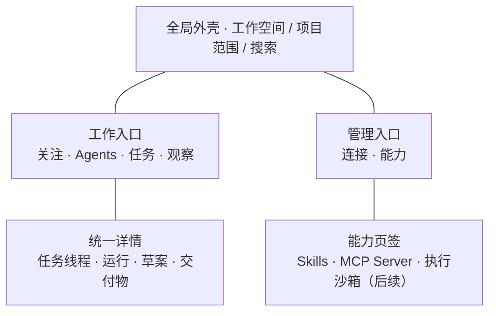

# Tandem 设计规范（v2）

> 当前变更（2026-11-14）：用户已授权按项目、文档、任务、分析、Agents、连接器、后台管理重构。新增业务与视觉以 [08 产品重构与验收](08-产品重构与验收.md) 和 apps/web/DESIGN.md 为准，覆盖下文旧六入口、旧Logo、旧视觉和仅外部项目任务的规定；其余权限、草案、进程与隔离约束继续有效。下文旧验收为历史记录。

> 依据 [01-产品设计文档](./01-产品设计文档.md) 与 [02-技术架构文档](./02-技术架构文档.md) 重新定义，作为后续产品设计、前端开发和体验验收的基线。
>
> 2026-11-12 · 本文规定目标体验与设计约束，不表示对应功能已经实现或验收。

## 0. 设计目标与适用边界

**让指挥官看清需要关注的事，让 T 组在授权范围内持续工作，让每次交付都有可以验证的结果。**

面向需要同时推进多个团队和项目的人，以及参与具体任务的成员。产品以桌面工作台为主，移动端支持查看进展、提请决策的处理和结果确认。主要使用场景是日常操作，不采用营销页的大标题、大插画或装饰性数据面板。

三份文档分别回答：01 定义产品做什么，02 定义系统如何支撑，03 定义用户如何看见、操作和理解。本文只设计这两份上游文档明确的产品能力；新增业务范围先回到 01，技术约束变更回到 02。

### 0.1 不可偏离的设计原则

| 原则 | 必须体现的行为 |
|---|---|
| 先决策，后信息 | 需要人处理的事项优先于常规进度；每项说明影响、责任人和可执行动作 |
| 人与 Agent 同台协作 | 任务、线程、产物与验收共用交互规则；Agent 用身份标记区分，不另造一套聊天产品 |
| T 组是默认团队 | 默认显示产品设计师、技术架构师、研发工程师三名 Agent；支持整组派活与指定成员 |
| 事实与推断分开 | 展示来源、更新时间和估算依据；未知、未授权、过期均不能显示为空闲或正常 |
| 完成必须有证据 | 草案、审批、执行、交付、部署分别表达；模型回答结束不等于任务完成 |
| 业务与对接分离 | 业务页面使用统一产品术语；具体协作系统名称、原始错误和协议配置只在连接管理及技术详情中出现 |
| 克制但清晰 | 蓝白中性基调、紧凑排版、明确分隔；不靠大面积彩色、动画或多层卡片组织信息 |

### 0.2 版本范围

| 阶段 | 设计覆盖 | 界面约束 |
|---|---|---|
| v2.0 / 一期 | 六个入口的基础体验；默认 T 组、派活、线程、运行与审批、Demo/部署交付；Skills 安装管理与使用、MCP Server 管理；基本隔离执行 | 只显示可用能力；观察页先提供有真实依据的基础列表，不假装已具备高级推荐 |
| v2.1 | Skills 自主积累、候选验证与版本迭代；执行沙箱管理 | 在能力页增加对应视图，沿用权限、状态与产物规则 |
| v2.2 | 项目知识增量检索、引用回链、多项目执行治理 | 在任务/运行详情中增强上下文，不另建平行任务系统 |
| v2.3 | 负载指数、空档日历、推荐和第二连接器的完整体验 | 具备足够数据才给出指标与推荐；显示计算依据与置信度 |

后续能力不在一期主操作区域摆放不可用的占位按钮。已交付功能因未配置或权限不足不可用时，才显示具体原因与解决入口。

## 1. 产品对象与语言

### 1.1 用户必须能区分的对象

| 对象 | 用户理解 | 展示与边界 |
|---|---|---|
| 工作空间 | 团队协作与配置的归属范围 | 全局可见；切换后所有数据、搜索和能力绑定都跟随切换 |
| 项目 | 目标及资源的业务上下文 | 业务事实通过连接器读取；显示名称与连接来源的可访问详情，不复制一套项目状态 |
| 任务 | 对外协作系统中有事实状态的工作项 | 看板、列表与任务线程使用同一引用；不能把 Agent 内部步骤混进任务列表 |
| 交付目标 | 一次交给 T 组或成员的工作要求 | 包含模式、范围、验收、期限、预算，可关联外部任务；未创建外部任务时明确标注“尚未关联任务” |
| 运行 | Agent 对目标的一次执行记录 | 展示阶段、成员、状态、事件、预算和产物；暂停与失败可追溯 |
| 草案 | 尚未执行的对外操作或发布方案 | 展示具体变更及审批版本；批准后仍有独立执行结果 |
| 交付物 | 可以查看、运行或验证的工作结果 | 展示版本、预览/下载、证据、限制与有效期；按项目授权访问 |
| Skill | 可安装和复用的方法及资源 | 名称、说明、来源、版本、权限、绑定范围；与技能标签分开 |
| MCP Server | 向 Agent 提供工具的服务 | 注册、连通、可用工具与授权是不同状态 |
| 执行沙箱 | 运行代码和工具的受控环境 | 后续管理模板、实例、资源、租约与回收；不等同于部署目标环境 |

### 1.2 命名与文案

- 一级导航固定为：**关注、Agents、任务、观察、连接、能力**。文案以中文为主，Skills 与 MCP Server 保留产品名称。
- 默认团队名为“T 组”；成员显示“产品设计师”“技术架构师”“研发工程师”，详情中展示完整角色定位。
- 人名示例使用张三、李四；演示项目使用“项目 A”“项目 B”，样例和模拟数据明确标识，禁止混入真实姓名、凭证或伪造业绩。
- 操作名称直接表达动作及对象，如“交给 T 组”“批准并部署”“启用技能”“重新连接”；避免“确定”“智能处理”等含糊主按钮。
- 错误先说明用户影响，再给可执行动作；错误码、run ID 和工具输出放入可展开的技术详情。
- 日志与线程展示可验证的动作、结论和证据，不展示模型内部推理过程，不把输出字数当工作进度。

## 2. 信息架构与导航

### 2.1 六个一级入口

| 入口 | 回答的问题 | 主要内容 | 主动作 |
|---|---|---|---|
| 关注 | 现在什么需要我处理？ | 待决策、待审批、阻塞、期限风险、负载/空档与团队动态 | 派活；处理最优先事项 |
| Agents | T 组和其他成员在做什么？ | 团队、成员、交付目标、运行、已绑定能力与交付物 | 交给 T 组；查看运行 |
| 任务 | 工作项进展如何？ | 看板/列表、负责人、期限、事实状态、任务线程 | 查看/处理任务；创建任务 |
| 观察 | 哪些容量和趋势需要调整？ | 基础负载列表；后续空档日历、趋势和推荐解释 | 筛选与定位风险对象 |
| 连接 | 业务数据接入是否可用？ | 协作连接器、当前账号授权、读取状态及异常 | 添加连接；重新认证 |
| 能力 | Agent 能使用什么？ | 一期 Skills、MCP Server；后续执行沙箱 | 安装技能；添加 MCP Server |

工作空间、项目筛选、个人账户位于全局外壳。模型配置进入 Agent/团队配置，文档与产物进入项目上下文或运行详情；不为这些内容扩充一级导航。

“连接”管理业务事实源，“能力”管理 Agent 方法、工具和执行环境。两者不能混成一个名称相同、用途不同的服务列表。

### 2.2 结构总览

图只表示信息归属，不表示执行流程。详情在所属页面打开，保留来源和筛选上下文。

### 2.3 全局外壳与布局

| 区域 | 桌面基准 | 行为 |
|---|---|---|
| 侧边导航 | 展开 208px，收起 64px | 固定顺序；当前入口以浅蓝底、文字和指示线共同标记，不仅靠颜色 |
| 顶部栏 | 高 56px | 工作空间与项目范围清晰；账户和全局搜索固定位置 |
| 内容区 | 外边距 24px，窄桌面 16px | 页面标题、说明、主操作在第一行；筛选在第二行；数据/工作内容随后展开 |
| 阅读区域 | 正文宽度不超过 72ch | 线程、方案、错误详情限制行长；表格和代码可使用完整宽度 |
| 详情抽屉 | 默认 640px，不超过视口宽度 60% | 保留列表上下文；复杂 diff、部署方案可在同一入口内展开为全宽详情 |
| 能力配置表单 | 单列，主要区域不超过 720px | 先必要项，后高级项；多组配置用分节与页签，不层层嵌套卡片 |

内容页只设一个页面级主按钮。单个待办或审批面板可有自己的主动作，但不能让整屏每一行都出现实心蓝按钮。优先采用行、表格、分隔线与留白，卡片用于真正独立的概览对象。

### 2.4 搜索、筛选与返回

- `Ctrl+K` / `⌘K` 打开全局命令；按任务、项目、人、Agent 分组展示结果。搜索范围明确，结果先校验权限，不能泄露不可见对象的标题或命中数量。
- 中文输入法组合输入期间不响应提交快捷键。搜索框为空时展示常用入口，不制造虚构推荐。
- 项目、团队、成员、状态、时间范围按页面需要组合；可见筛选条件保持简洁，更多条件在展开区。排序/筛选可进入 URL，凭证和敏感输入不得进入 URL。
- 打开详情、处理后返回时保留筛选、分页与滚动位置。支持详情深链接；刷新后恢复相同授权范围内的上下文。

## 3. 六个页面的体验规范

### 3.1 关注：决策清单优先

首屏顶部是紧凑的派活输入区；下面先放待处理事项，再放团队概况。1366×768 视口中应能看到输入区、优先事项标题和至少一条有效事项，不使用占据半屏的欢迎语或大指标卡。

| 顺序 | 区域 | 每条最少信息 |
|---|---|---|
| 1 | 需要我决策/审批 | 项目、提出者、问题或动作、影响、等待时长、处理入口 |
| 2 | 阻塞与期限风险 | 对象、阻塞原因/期限、影响范围、负责人、下一步 |
| 3 | 谁过载、谁有空档 | 人/Agent、容量依据、适用时间、置信度；未知显示“待评估” |
| 4 | 项目趋势与团队动态 | 时间范围、来源、可验证产出、定位详情入口 |

同一根因造成的多条阻塞合并显示数量与展开入口，避免告警刷屏。没有待处理事项时显示“当前没有需要你处理的事项”，保留派活和运行概况，不将零事项包装成庆祝页面。

### 3.2 Agents：以 T 组的目标和产出组织

默认进入 T 组概览；有多个团队时提供团队选择，不把单个成员的聊天窗作为默认首页。

团队概览由目标摘要、三个成员行、当前运行列表和最近交付物组成。目标摘要展示模式、项目、期限、预算及是否需要人工处理；三名成员行展示职责、当前工作、可用状态和已绑定能力摘要。未配置模型、执行环境或授权时，显示具体缺失项及配置入口。

运行详情使用固定结构：

1. **概览**：目标与验收、阶段、负责人、运行状态、预算与更新时间。
2. **活动**：结构化事件、决策、工具结果摘要和错误；默认展示有意义的变化，不输出每个 token。
3. **产物**：设计、技术/部署方案、代码/变更、测试证据、Demo 与部署记录。
4. **上下文与能力**：所用文档、技能版本、工具服务及授权范围。

阶段条体现产品设计、技术/部署设计、开发测试、交叉验收、部署验证、交付等阶段；不强制将实际依赖图假装成等时长步骤，不凭模型文字生成百分比。产品设计师负责体验，架构师负责技术与部署设计，工程师负责开发、测试及获批部署；界面不增加第四个“管理者 Agent”。

Agent 成员可参与多个目标。成员状态由实际运行与容量推导；团队内有成员空闲，不代表整个目标无阻塞或团队可以无条件接新任务。

### 3.3 任务：业务工作项与协作线程同屏

默认列表支持名称、负责人、状态、优先级、期限、剩余工作量及所属项目；看板与列表是同一数据的两种表达。状态以连接器映射后的统一语义显示，原始系统字段只在连接详情中出现。

打开任务详情后，上部为事实字段和更新时间，下部为协作线程及关联运行/产物。人的留言、Agent 的结论、系统状态变更使用不同的作者标记；正文排版一致，不堆叠多层对话气泡。

- 单击名称打开详情；复选框只负责选择，不同时打开详情。批量操作先显示已选范围和可操作数量。
- 不默认提供拖拽改变业务状态。若实现拖拽，必须有等价键盘操作，并走相同权限、校验和提交机制；失败时恢复原状态并保留原因。
- 待提交的变更与已确认的业务事实分开显示。Agent 生成的草案不能提前移动任务卡片或显示“已完成”。
- 任务不可见或已删除时说明“对象不可用或无访问权限”，不展示缓存中的旧正文。

### 3.4 观察：解释容量，不伪造精确性

一期提供基于可见事实的工作量、期限和运行列表。后续加入负载排行、空档日历及趋势切片。数据稀疏时展示已知事实与缺失项，不以 0 补齐缺失数据。

人和 Agent 可以混排，详情必须解释各自计算口径；人的工时、Agent 的运行时长和模型成本分别列示。团队容量显示阶段依赖与瓶颈，不能简单相加三个成员的容量。

所有图表标注时间范围、单位、更新时间及数据覆盖；提供表格等价视图。负载沿用 01 的阈值：大于 80 为高负载、60–80 为接近饱和、低于 60 为常规；同时显示文字。只有已定义且有样本的指标才展示分数、趋势和成功率。

### 3.5 连接：看清接入与用户授权

连接列表展示连接名称、系统类型、可达性、当前用户授权状态、最近成功读取时间和问题摘要。可达、已登录、有权限、数据完整是不同事实，不合并为一个“正常”。

连接详情按“基本配置、账号授权、能力与状态、活动记录”组织。支持的读取/写入能力由服务端返回；不支持工时、删除等动作时说明原因，不让用户先操作再看到通用报错。

连接成功后业务页面即可聚合有权访问的数据，不使用“已同步入库”等暗示复制业务库的文案。需要重新认证时回到当前连接，成功后恢复原操作上下文；不得自动重放未经重新核验的对外写入。

### 3.6 能力：方法、工具、环境分别管理

一期页签为 **Skills、MCP Server**；后续增加 **执行沙箱**。当前页签的主按钮随对象变化：安装技能、添加 MCP Server、创建沙箱。

**Skills**

列表展示名称、用途、来源、启用版本、状态、绑定范围与最近使用。详情展示说明、依赖与权限、版本、绑定和使用记录。

安装表单先选择仓库或技能包，再展示可固定的版本、来源、依赖、所需权限和安装范围。安装、启用、绑定是三个事实：已安装不等于全部成员可用，启用也不等于具备技能所需的工具授权。

升级前展示差异、权限变化和受影响绑定；升级不静默替换进行中运行所用版本。停用/卸载说明对后续调用的影响；权限变更不得通过升级隐藏发生。T 组自主安装同样记录来源、版本与范围，不另造无审计的安装路径。

**MCP Server**

列表展示服务名、连接方式、可达性、启用状态、工具数量及授权范围。详情按“连接、工具、授权、调用记录”组织；凭证使用引用或掩码，不回显完整密钥。

“测试连接”只验证连接和工具目录；“保存配置”“启用服务”“授权工具”分别表达。工具列表逐项显示用途、作用类型、允许范围和是否可调用；未知作用类型显示“待配置权限”，不能默认当只读。

远端契约变化、认证过期、服务停用与调用失败分别说明。连接成功不能直接提示“T 组已可使用全部工具”。这里管理 T 组接入的外部 MCP Server；Tandem 向外提供的 MCP 接入说明放在独立说明区，避免混淆两个方向。

**执行沙箱与 Skills 积累（后续）**

沙箱列表展示模板、关联目标、状态、资源限额、到期时间及占用者；详情展示网络/目录权限、运行日志和产物保全情况。销毁时明确哪些临时内容会删除、哪些产物已保存，正在运行的环境不能被误认为空闲。

技能候选区展示来源交付、适用条件、去重结果、验证证据与拟发布范围。候选、验证通过、已发布与已启用分别标记。允许查看失败原因、修订、停用及版本回退；自动积累的技能同样受项目权限限制。

## 4. 关键交互与完成标准

### 4.1 派活

输入自然语言目标后，在同一面板补齐模式（产品交付 / Demo）、项目、验收条件、期限、预算及执行对象。默认可选 T 组，也可指派具体成员；推荐有依据时显示理由，没有样本时只提供可用选项。

系统提取的范围、时间和预算为可编辑建议，不能悄悄扩大用户目标。开始前展示必要的配置缺口；能够直接在面板完成的配置不要求跨多页往返。

“开始执行”创建内部交付目标和运行；需要新建外部业务任务时单独展示相应操作。未关联外部任务的目标保存在 Agents 运行中，不冒充已写入任务列表。

### 4.2 决策与草案审批

决策用于回答方案、优先级或范围问题；审批用于授权具体对外操作。两者可以关联，但不能把回答一个问题当成批准所有副作用。

审批面板必须展示：操作摘要、目标项目/环境、受影响对象、实际执行身份、内容版本、逐项变更、校验结果和有效期。部署草案还需展示制品版本、部署步骤、验证与回滚方案。风险和范围变化放在主内容中，不藏在 tooltip。

- 主按钮使用“批准并执行”“批准并部署”等明确文字；同屏提供退回修改或拒绝。已明确确认的同一动作不再弹重复确认框。
- 批量批准只包含用户实际审阅并选中的有效动作；存在失败校验、权限变化或过期项时，明确列出不可批准项。
- 提交后锁定当前按钮并显示“执行中”，成功回执到达后才显示执行结果；刷新、双击和断线均不能造成重复执行。
- 内容版本变化后原批准失效；展示“内容已更新，请重新审阅”，不自动套用旧批准。
- 操作结果部分成功或无法确认时逐项显示，禁止“整体成功”提示和无条件“一键重试全部”。

### 4.3 部署与交付

部署视图中，方案责任人为技术架构师，执行责任人为研发工程师。指挥官批准后，工程师继续执行和验证；界面不能把后续操作变成“请用户手工部署”。

交付物按用途列出，默认先看可运行入口和验收结论，再看源码、方案与证据。显示版本、环境、验证时间、验收人/Agent 及已知限制。

Demo 明确标识模拟数据、演示范围、未实现项与预览有效期；预览失效不等于代码丢失，应提供可用的恢复预览或启动说明。正式部署只有目标环境健康检查通过才显示“部署成功”；回滚后显示“已回滚至版本 …”，不能沿用成功发布状态。

### 4.4 配置与退出

表单字段有常驻标签、必要的格式示例和就近错误；占位符不能替代标签。保存失败保留已填内容，密钥等敏感值例外，并说明需要重新输入。

非敏感未保存内容离开时提示保存或放弃；删除、停用、销毁仅在有实际影响时展示具体确认。退出登录/切换工作空间后清空不再有权访问的页面与缓存，不能保留旧详情作为可继续操作的状态。

## 5. 状态与反馈

### 5.1 运行状态

| 系统状态 | 用户标签 | 默认呈现与动作 |
|---|---|---|
| `queued` | 排队中 | 展示等待原因；有依据才显示预计等待时间；允许取消 |
| `running` | 执行中 | 当前阶段、负责成员、最后事件、预算；允许取消，不假设支持任意时刻手动暂停 |
| `waiting_decision` | 等待你决策 | 问题与备选方案；提交回答后展示续跑状态 |
| `waiting_approval` | 等待审批 | 指向具体草案及影响；可审阅、批准或退回 |
| `waiting_auth` | 等待重新授权 | 说明失效范围、重新认证入口；重新校验后续跑 |
| `completed` | 本次执行完成 | 展示对应阶段的验收证据；交付目标另按完整验收条件标记“已交付” |
| `failed` | 执行失败 | 原因、已完成部分、证据及可用恢复动作；不默认重放副作用 |
| `cancelled` | 已取消 | 标明取消时间、已发生动作及保留产物；不暗示已撤销外部写入 |

取消请求发出后到实际停止前显示“正在取消”，这是交互过渡状态；收到确认前不能直接显示“已取消”。主服务正常但后台执行不可用时显示“执行服务暂不可用”，保留已有运行及产物的查看能力。

### 5.2 草案与动作结果

| 用户状态 | 说明 | 可用动作 |
|---|---|---|
| 待审阅 | 未获批准、尚未执行 | 审阅、退回、拒绝 |
| 已批准 / 等待执行 | 批准已记录，副作用尚未确认发生 | 查看进展；不显示再次批准 |
| 执行中 | 已领取动作，等待结果 | 查看进展，不重复提交 |
| 全部成功 | 每项均有成功回执 | 查看回执和最新业务事实 |
| 部分成功（`partial`） | 已完成项与失败项分开 | 仅按服务端允许范围处理未完成项 |
| 结果待核对（`unknown`） | 外部是否成功尚无法确认 | 查询/核对结果或提请处理，不盲目重试 |
| 已拒绝 / 已过期 / 已失效 | 无法按原版本执行 | 修改或重新提交审阅 |

以上为用户语义，具体枚举由应用服务映射；前端不得根据按钮点击自行推断最终状态。

### 5.3 页面与数据状态

| 状态 | 设计规则 |
|---|---|
| 首次加载 | 使用与最终布局一致的静态骨架；无闪烁、无整屏转圈；容器高度稳定 |
| 局部刷新 | 保留仍有权限的数据与筛选，标明更新中；禁止页面闪回空态 |
| 空数据 | 区分未配置、无数据、筛选无结果、无权限；分别提供配置、派活、清除筛选或联系负责人的说明 |
| 部分数据失败 | 显示已成功部分、缺失范围和最近成功时间，不悄悄降低统计分母 |
| 网络断开 | 保留可查看内容并标记“连接中断”；暂停依赖实时校验的写操作，恢复后先核对状态 |
| 会话失效 / 权限撤销 | 清除敏感详情，说明重新认证或权限不足；不能继续展示旧搜索结果 |
| 长时间无新事件 | 显示最后更新时间与已知状态；沉默不自动判失败或成功 |
| 外部数据过期 | 显示最近成功读取时间，允许刷新；估算与事实均带清晰来源 |

系统事件断线重连按序号补齐并去重，不重复追加通知或重新触发操作。切换工作空间/项目时旧请求和旧事件不得覆盖新范围。进度推送只更新变化区域，不让焦点、滚动位置或用户选中的文字跳动。

## 6. 视觉体系

### 6.1 基调

遵循 01、02 的蓝白中性体系：主色 `#3964FE`，正文 `#0F1115`，背景 `#F9FAFB`，内容面 `#FFFFFF`，分隔线 `#E9EAF0`。不使用阴影、渐变、玻璃质感、装饰性光效或大圆角。信息层级靠对齐、留白、字重与边界建立。

Logo 使用单色 Tandem 字标与双人自行车抽象符号；图标使用同一套线性图形，16px 或 20px，语义相同的操作全站复用。不用 emoji 作为品牌、导航或状态图标。

### 6.2 颜色 token 与用途

| Token | 值 | 用途 |
|---|---|---|
| `--color-primary` | `#3964FE` | 主动作、链接、当前选择与焦点；不作大面积装饰 |
| `--color-primary-soft` | `#EEF2FF` | 选中项背景；搭配正文或满足对比度的文字 |
| `--color-text` | `#0F1115` | 标题、正文、核心数据 |
| `--color-text-secondary` | `#626B78` | 说明、时间、次要数据等需要阅读的内容 |
| `--color-neutral-muted` | `#81858C` | 中性图形、非必要装饰；不作为白底 14px 正文色 |
| `--color-background` | `#F9FAFB` | 页面底 |
| `--color-surface` | `#FFFFFF` | 内容面、菜单、抽屉、对话框 |
| `--color-divider` | `#E9EAF0` | 非交互区域的轻分隔线 |
| `--color-control-border` | `#81858C` | 需要明确识别的输入边界；不能以浅分隔线替代控件可见性 |
| `--color-success-marker` / `--color-success-text` | `#22C55E` / `#15803D` | 成功状态点 / 可读的成功文字 |
| `--color-warning-marker` / `--color-warning-text` | `#F59E0B` / `#A16207` | 警示状态点 / 可读的警示文字 |
| `--color-danger-marker` / `--color-danger-text` | `#EF4444` / `#B42318` | 错误状态点 / 错误文字、危险动作文字 |

01、02 的 `#81858C` 作为中性基色保留，正文辅助信息使用其更深的可读性派生色；三种状态色同样区分标记与文字。状态点为 6px，始终伴随文本或图形，颜色不能作为唯一识别依据。

白底计算结果：`#3964FE` 约 4.74:1，`#626B78` 约 5.39:1，`#81858C` 约 3.71:1，因此后者不能用于要求 4.5:1 的小字号正文。具体组件仍需按实际前景/背景组合验收；浅蓝选中底、hover 和禁用态不能直接套用白底结果。[W3C 文本对比度说明](https://www.w3.org/WAI/WCAG22/Understanding/contrast-minimum.html)

### 6.3 字体、间距与尺寸

| 类别 | 规范 |
|---|---|
| 字体 | Inter + 系统中文无衬线栈；代码与 ID 使用系统等宽栈；字体未加载时布局仍稳定 |
| 页面/区块标题 | 14px、字重 600，以位置和留白分级，不用巨型标题 |
| 正文/输入/按钮 | 14px、字重 400 或 500，正文行高 1.5–1.6 |
| 辅助文字 | 13px；12px 仅用于非关键注记，不承载审批范围、错误原因等关键信息 |
| 数字与金额 | 同字号，表格使用等宽数字；保留单位与合理精度，不用大数字挤占首屏 |
| 间距 | 4 / 8 / 12 / 16 / 24 / 32px；组件内 8–12，区块内 16，区块间 24–32 |
| 圆角 | 控件 6px、卡片/抽屉/弹层 8px；不超过 10px |
| 控件 | 常规按钮/输入高 36px，紧凑表格内 32px；触屏交互区域至少 44×44px |
| 行高 | 常规表格行 44px，含双行摘要时至少 60px；不通过缩到难读字号塞入更多列 |
| 边界 | 常规 1px；焦点使用清晰的 2px outline 并保留间距，不用阴影模拟焦点 |

日期默认 `YYYY-MM-DD`，需要时刻时附 `HH:mm` 与时区提示；相对时间可辅助显示，悬停或详情可见完整时间。项目期限用明确日期，预算用明确币种/单位；缺失值显示“未设置”或“未知”，不默认为零。

### 6.4 动效

只允许约 150ms 的 hover 颜色变化。页面、抽屉、列表不使用入场编排、弹跳、缩放或闪烁；骨架不做 shimmer，状态更新不造成布局跳动。减少动态效果设置下禁用非必要过渡，操作反馈主要依靠文字和状态变化。

## 7. 组件与交互一致性

| 组件 | 统一规则 |
|---|---|
| 按钮 | 主、次、文字、危险四种语义；有 loading/disabled 与原因；危险操作不借主色伪装普通继续 |
| 表单 | 标签常驻；必填、帮助与错误就近展示；支持键盘提交，异步校验不能覆盖用户后续修改 |
| 状态标记 | 文本 + 小标记；标签短且稳定，完整原因进入详情；不同对象状态不共用含糊的“正常” |
| 表格/列表 | 表头、排序、空态和选择行为统一；名称可访问，数字右对齐；筛选后明确总量口径 |
| 任务/运行详情 | 共享头部、状态、关联对象、更新时间与产物区；同一运行从不同入口打开内容一致 |
| 抽屉 | 用于不丢列表上下文的详情；关闭回到触发位置；禁止抽屉套抽屉 |
| 对话框 | 仅用于有界确认、必要输入和聚焦决策；标题、影响、主次按钮明确，关闭不丢失已提交结果 |
| 菜单/浮层 | 通过顶层挂载避免被滚动容器裁剪；层级顺序为基础内容、固定栏、菜单、抽屉、对话框、通知 |
| 通知 | 成功可短暂通知，失败/需处理事项必须在内容区保留；不以 toast 替代部署或审批回执 |
| 代码/diff | 独立横向滚动、可复制、显示文件与版本；默认折叠长日志，展开不撑宽整页 |
| 产物条目 | 类型、名称、版本、状态、可访问入口、有效期；不可访问时明确原因与下一步 |
| 引用 | 文档名、版本、章节/片段；点击后定位到有权查看的来源，失效时说明而非打开空白页 |

交互组件覆盖默认、悬停、焦点、按下、禁用、提交中、失败状态。禁用原因不能只放在不可聚焦的按钮 tooltip 中，应在附近提供可读说明。

## 8. 响应式与可访问性

### 8.1 断点行为

| 可用宽度 | 布局 |
|---|---|
| ≥1280px | 208px 侧栏；主要列表可与详情并排；内容使用 24px 外边距 |
| 960–1279px | 侧栏默认可收起；优先保留任务名称、状态、负责人和主操作；复杂详情采用覆盖式抽屉 |
| 640–959px | 导航改为可展开入口；筛选折叠；详情占据主要区域，避免三栏压缩 |
| <640px | 单列；详情与表单全宽；操作栏不遮挡内容，支持安全区域；触屏目标增大 |

上述为设计默认值，不做屏幕型号判断。长表格采用列优先级、行详情或容器内横向滚动，整页不得横向溢出。手机上长代码/diff 和部署审阅允许展开并滚动，不通过截断隐藏关键范围；移动端不得扩大或简化审批权限。

### 8.2 验收要求

- 正常正文对比度至少 4.5:1；焦点、控件边界和必要非文本信息按实际背景检查可辨识性。颜色之外提供文字或图形解释。
- 所有主要操作可用键盘完成；焦点顺序与阅读顺序一致，抽屉/对话框管理焦点并在关闭后归还，焦点不能被固定栏遮挡。
- 图标按钮有可读名称；表单标签、错误与字段正确关联；状态变化通过合适的可访问提示播报，运行事件不逐条打断用户。
- 放大文字、长中文/英文、缺失头像和字体回退不遮挡内容；200% 缩放时关键操作仍可达。
- `Esc` 关闭非提交中的临时层；输入未保存时按实际丢失风险处理。不能依赖 hover 才能查看审批信息或错误详情。
- 表格有结构化表头，图表有文字/表格等价信息；拖拽、颜色、动画均不能成为唯一操作或信息载体。

## 9. 前端实现契约

本节只约束实现方式如何支持体验，开发细节不进入普通用户流程。

- Next.js 主服务以同一端口提供页面与 API，前端不提供“选择后端地址”等内部架构配置；独立 Worker 的状态转译为运行排队、执行服务不可用等业务反馈。
- 颜色、字体、间距、圆角、尺寸使用统一 token；CSS 变量为单一来源，映射到 antd theme，禁止每页另定义一套近似值。
- 工作空间、用户/权限、连接与查询范围进入数据缓存边界；撤权、退出或切换范围后清除敏感结果，禁止服务端跨用户缓存个人聚合页。
- 事件订阅和轮询使用同一运行状态模型，支持断线恢复与去重；UI 不自行生成业务事实、审批状态或完成比例。
- 外部写成功后刷新相关事实；可乐观更新本地视图偏好等可逆操作，不乐观宣布部署、工时登记或任务创建成功。
- 分页、长列表窗口化与代码按需加载服务于可读性；不能因虚拟化丢失键盘焦点、已选项或屏幕阅读顺序。
- 凭证不进入 URL、客户端日志、通知或截图样例；有权查看配置不等于有权看到明文密钥。
- 原生组件能力优先复用；仅对领域语义封装如成员身份、运行状态、审批面板、能力绑定和交付物条目，避免通用容器无限嵌套。

## 10. 设计交付与验收

### 10.1 交付内容

每个页面或功能至少提供：使用场景与主动作、信息层级、正常与关键异常状态、桌面/窄屏布局、交互说明、token/组件引用、权限范围和可验证验收条件。设计师交付体验规范，架构师复核状态及权限可实现性，工程师提交实现与验证证据。

原型与演示数据始终注明样例性质；评审图优先展示模块与信息关系，流程细节写在对应交互说明中，不绘制难以阅读的巨型流程图。

### 10.2 一期验收场景

| 场景 | 通过条件 |
|---|---|
| 首次使用 | T 组三人只初始化一次；未配置项清楚，能从提示完成配置并开始一个目标 |
| 关注首屏 | 小尺寸笔记本可看见派活入口及优先事项；无数据和需处理状态都有明确下一步 |
| T 组协作 | 三个角色职责明确；用户能区分任务、运行、草案与产物，看到版本和验收证据 |
| Demo 交付 | 可运行入口、模拟范围、演示说明和有效期可见；静态截图不被标为可运行 Demo |
| 部署交付 | 部署方案、执行身份、目标环境和版本可审阅；执行、失败、回滚与健康检查结果准确 |
| Skills | 安装、启用、绑定、升级、停用状态可区分；运行使用版本与权限影响可追溯 |
| MCP Server | 连通与授权分别显示；测试连接无业务写入；不可调用工具有可理解原因 |
| 审批异常 | 双击/刷新不重复执行；版本变化需重审；部分成功与结果未知不显示整体成功 |
| 后台异常 | Worker 不可用时管理页仍可查看；重连后事件不重复、状态不倒退、不自动重放写入 |
| 数据与权限 | 无权限不泄露标题/旧正文；部分读取失败不伪造完整统计；切换空间不串数据 |
| 窄屏与可访问性 | 键盘可完成派活和审批；焦点、对比度、200% 缩放、长文本及触屏目标经过检查 |

v2.1 追加技能候选验证/发布与沙箱生命周期验收，v2.2 追加知识引用和索引版本验收，v2.3 追加负载/趋势口径与推荐解释验收。不能以设计稿存在、构建通过或模型声明替代实际交互验证。

本规范重写的完成标准是信息与规则完整、一致、可实施；界面达到规范仍须在后续开发中进行视觉和交互验收。
